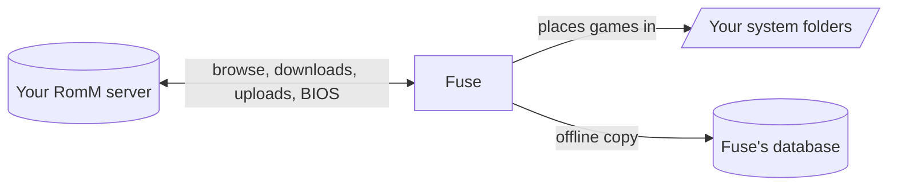
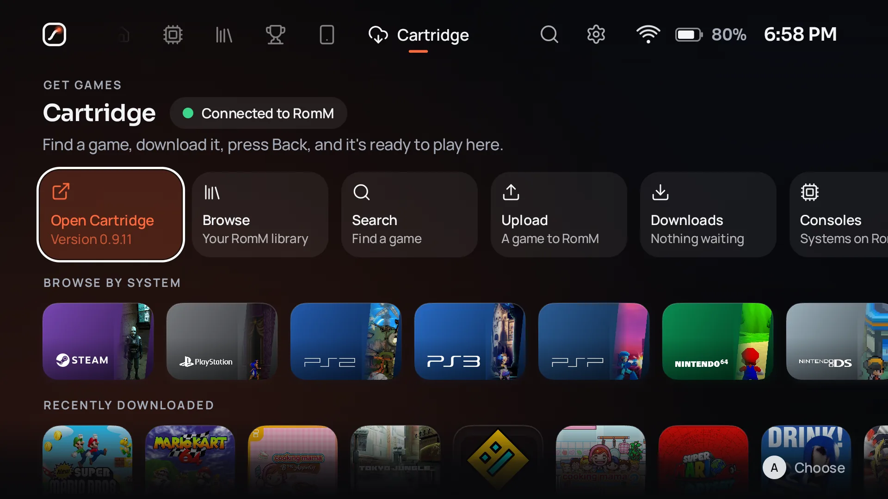
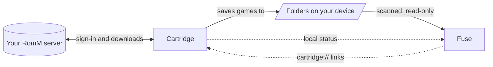

<div align="center">

<picture>
  <source media="(prefers-color-scheme: dark)" srcset="docs/assets/brand/banner-dark.svg">
  <source media="(prefers-color-scheme: light)" srcset="docs/assets/brand/banner-light.svg">
  
</picture>

<h3>Point it at your folders. Pick up a controller. Play.</h3>

Fuse gathers the games in your folders, dresses them in art and starts each one in the emulator you
already use, all from a console-style interface made for a gamepad. On Android it can even be your
Home screen.

<a href="https://github.com/MAtiyaaa/fuse/releases/latest"></a>
<a href="https://matiyaaa.github.io/fuse/"></a>

<a href="LICENSE"></a>
<a href="#privacy"></a>

<br>

<a href="https://github.com/MAtiyaaa/fuse/releases/latest"><picture><source media="(prefers-color-scheme: dark)" srcset="docs/assets/brand/button-android-dark.svg"></picture></a>
&nbsp;
<a href="https://github.com/MAtiyaaa/fuse/releases/latest"><picture><source media="(prefers-color-scheme: dark)" srcset="docs/assets/brand/button-linux-dark.svg"></picture></a>
<br>
<a href="https://github.com/MAtiyaaa/fuse/releases/latest"><picture><source media="(prefers-color-scheme: dark)" srcset="docs/assets/brand/button-windows-dark.svg"></picture></a>
&nbsp;
<a href="https://github.com/MAtiyaaa/fuse/releases/latest"><picture><source media="(prefers-color-scheme: dark)" srcset="docs/assets/brand/button-macos-dark.svg"></picture></a>

<sub>Android 9 or newer &nbsp;·&nbsp; 64-bit x86 Linux AppImage &nbsp;·&nbsp; Windows 10 and 11 &nbsp;·&nbsp; macOS on Apple silicon and Intel &nbsp;·&nbsp; <a href="#install">checksums and install notes</a></sub><br>
<sub>0.4.3.10 is the <b>Overdrive Update</b>: recomps beside your emulators, ports and recomps on Android, themes that move and resize things, and Steam changed while it runs</sub><br>
<sub>Or download from <a href="https://matiyaaa.github.io/fuse/">Fuse's website</a>, which always offers the latest version for your system.</sub>

<br>

<b><a href="#a-dark-room-lit-by-the-game-youre-on">Tour</a></b> &nbsp;&nbsp;·&nbsp;&nbsp;
<b><a href="#made-by-fuse">Made by Fuse</a></b> &nbsp;&nbsp;·&nbsp;&nbsp;
<b><a href="#everything-in-its-place">Features</a></b> &nbsp;&nbsp;·&nbsp;&nbsp;
<b><a href="#install">Install</a></b> &nbsp;&nbsp;·&nbsp;&nbsp;
<b><a href="#romm-fuses-native-romm-integration">RomM</a></b> &nbsp;&nbsp;·&nbsp;&nbsp;
<b><a href="#romm-through-cartridge">Cartridge</a></b> &nbsp;&nbsp;·&nbsp;&nbsp;
<b><a href="#build-it-yourself">Build</a></b> &nbsp;&nbsp;·&nbsp;&nbsp;
<b><a href="#documentation">Docs</a></b>

</div>

<picture>
  <source media="(prefers-color-scheme: dark)" srcset="docs/assets/brand/divider-dark.svg">
  
</picture>

<div align="center">

## A dark room, lit by the game you're on

Every game, everywhere it lives: on this device, on your RomM server and on your other devices, in
one Library, with its art, its logo and where it is. The game you are on sets the mood, and the
tile under your thumb lifts toward you with a single sweep of light.

<a href="docs/assets/screenshots/library.webp"></a>

<sub><b>Library, All.</b> 348 games from this device, RomM and the household, in shelves you reach with a press.</sub>

<br><br>

<a href="docs/assets/screenshots/tour.mp4"></a>

<sub><b>A short tour.</b> <a href="docs/assets/screenshots/tour.mp4">Watch it as a video</a>.</sub>

</div>

<table>
  <tr>
    <td width="50%" valign="top">
      <a href="docs/assets/screenshots/game-page.webp"></a>
      <br><b>A page for every game</b>
      <br><sub>Its details, how long it takes to beat, its achievements, where it is, its saves, patches and cheats, and which emulator starts it.</sub>
    </td>
    <td width="50%" valign="top">
      <a href="docs/assets/screenshots/systems.webp"></a>
      <br><b>Systems, with art of their own</b>
      <br><sub>Logos, art and colours for 157 systems, each with its game count, its emulator and its own page.</sub>
    </td>
  </tr>
  <tr>
    <td width="50%" valign="top">
      <a href="docs/assets/screenshots/jellyfin.webp"></a>
      <br><b>Films, shows and music</b>
      <br><sub>Your Jellyfin server, played by Fuse Player: continue watching, next up, seasons, music and search.</sub>
    </td>
    <td width="50%" valign="top">
      <a href="docs/assets/screenshots/home-channels.webp"></a>
      <br><b>Home, a board you arrange</b>
      <br><sub>Continue playing, your systems, what's new, picks for you, achievements, Jellyfin and more, as tiles you place and resize.</sub>
    </td>
  </tr>
</table>

<p align="center"><sub>Captured from Fuse 0.4.2.13 and earlier on Linux at 1920 x 1080, with a real household library, RomM and Jellyfin, and the art Fuse filled
in for them. The games, films, their names and their art belong to their owners.
Fuse comes with no games and is not affiliated with them.</sub></p>

<picture>
  <source media="(prefers-color-scheme: dark)" srcset="docs/assets/brand/divider-dark.svg">
  
</picture>

<div align="center">

## Made by Fuse

The parts you feel most are Fuse's own: written for Fuse, in this repository, under its licence.
They behave the same on every device, answer to one design, and get better with every release.

</div>

<table>
  <tr>
    <td colspan="2" valign="top">
      <br>
      <h3>Fuse One <sub>by Fuse</sub></h3>
      Your household in one place: Fuse Profiles, Fuse Save Sync and the Fuse Library. Your saves,
      play time, library, settings and keys, the same on every device you play on, from a computer of
      your own at home (or the Fuse One Host, on its own in Docker). Without a host, each person's
      saves are still kept apart on the device. Stop on the PC, carry on on the handheld; nothing goes
      to anyone else's server, and nothing is ever silently lost.
      <ul>
        <li><b>Saves where you play.</b> The newest save is put in place before a game starts and kept
        after it closes, matched by the game, not the path, in over 60 emulators: RetroArch,
        DuckStation, PCSX2, PPSSPP, Dolphin, melonDS, DraStic, Mupen64Plus, RPCS3, Vita3K, shadPS4,
        Flycast, Azahar for 3DS, Eden and Ryujinx for Switch, Cemu for Wii U, Xenia and more. Save
        Folders shows where each one keeps them, and takes a folder you chose.</li>
        <li><b>Play time that adds up.</b> 30 minutes on one device and 20 offline on another is 50,
        never 30 and never 80. Everything works offline and catches up later.</li>
        <li><b>Synced everywhere, by itself.</b> A save made on one device reaches every other
        device with the game in the background, without launching it, and devices that were off
        catch up when they return. Each game says "Synced everywhere" or "4 of 5 devices current".</li>
        <li><b>Asks, never guesses.</b> When two devices both played, you choose which save to use;
        the other is kept. Every save keeps its versions, from every device, to go back to.</li>
        <li><b>A profile for each person</b>, with one of Fuse's own avatars and a PIN if they like:
        their own saves (even on a device everyone shares), library, favourites, collections, Home
        and theme, switched in place, no restart. Profiles work without a host too, and go with you
        when the device joins one. A game can be one save for everyone too.</li>
        <li><b>One click to host</b> on Linux, Windows or macOS, kept running when Fuse is closed and
        after a restart; devices find it on the network and ask to join (anyone already in says yes
        after checking a number), or type a code. The host plays as its own Admin. Signed requests,
        revocable devices, and an outside address for away from home.</li>
        <li><b>The Hub shows everything.</b> In Fuse and in a browser on the host: every game's saves
        and their versions, which device made each one, how big it is, where the host keeps it, and
        total play time by profile and by device.</li>
        <li><b>Only what you made.</b> Saves, states, memory cards, play time and settings; your games
        themselves are never copied or synced.</li>
        <li><b>Already run Syncthing?</b> Fuse can share your emulators' save folders through it
        instead, bring in the newest save before a game and ask when two devices both played.</li>
      </ul>
      <a href="docs/sync.md"><b>How Fuse One works</b></a> &nbsp;·&nbsp; <a href="tools/host/README.md"><b>The Fuse One Host</b></a>
    </td>
  </tr>
  <tr>
    <td width="50%" valign="top">
      <br>
      <h3>Fuse Player <sub>by Fuse</sub></h3>
      Fuse's own video and music player, for your films, shows and music from Jellyfin, with its own
      controls, subtitles and remote. Not a web page, not another app: part of Fuse.
      <ul>
        <li><b>Two engines, one player.</b> Media3 on Android; FFmpeg on Linux, Windows and macOS,
        decoding on the GPU where it can (VAAPI, D3D11VA, VideoToolbox).</li>
        <li><b>Starts fast, keeps playing.</b> A short first buffer, a deep one behind it, retries
        on a flaky link, and when Wi-Fi can't keep up, it lowers the quality by itself and carries on
        from the same second.</li>
        <li><b>Subtitles drawn by Fuse</b> on every platform: SRT, WebVTT, ASS with its styles, PGS
        and DVD pictures, with size, position and delay you set.</li>
        <li><b>Made for a controller</b>, with seeking that speeds up while held, and for touch:
        double tap to skip, drag the timeline, tap outside a sheet to close it.</li>
        <li><b>Two screens:</b> the film on one, a full remote on the other, swapped live while it plays.</li>
      </ul>
      <a href="docs/player.md"><b>How Fuse Player works</b></a>
    </td>
    <td width="50%" valign="top">
      <br>
      <h3>Fuseline <sub>by Fuse</sub></h3>
      Fuse's own animation engine, named after the line in Fuse's logo that carries the spark. Every
      movement in Fuse runs on it, from a tile's lift to the startup's spark. Fuseline 4.2 is
      the one in Fuse today.
      <ul>
        <li><b>Worked out when it is read.</b> Every motion is solved in closed form, so a value is
        exact for the frame being shown, without stepping through the frames before it.</li>
        <li><b>Left alone until it could be seen to change.</b> A value nobody is looking at rests,
        and comes back exactly where it would have been.</li>
        <li><b>Motion never breaks.</b> Interrupt anything moving and it carries on from where it is,
        at the speed it has.</li>
        <li><b>One frame for every move</b>, springs and curves shared and solved once, colours
        blended through Oklab.</li>
        <li><b>A fast first start (4.2).</b> Home with 2,348 games went from 10.1 seconds to about
        4.6 on a computer without a graphics card, and art is read from small copies kept on disk.</li>
        <li><b>Your motion choice everywhere</b>: Enhanced, Standard, Minimal, Reduced and Low Power.</li>
      </ul>
      <a href="docs/fuseline.md"><b>How Fuseline works</b></a>
    </td>
  </tr>
</table>

<div align="center">

| Each frame | Fuseline 4.2 | Fuseline 4 | Fuseline 3.1 | Fuseline 3 | Fuseline 2 | Fuseline 1 | Compose |
|---|--:|--:|--:|--:|--:|--:|--:|
| 1,000 springs given a new target every frame | **316 µs** | 748 µs | 1,341 µs | 1,363 µs | 1,287 µs | 8,762 µs | 28,264 µs |
| 1,000 values in mixed motions | **196 µs** | 398 µs | 413 µs | 373 µs | 445 µs | 430 µs | 3,136 µs |
| Tabs changed every 3 frames | **3.6 µs** | 5.0 µs | 6.4 µs | 6.1 µs | 9.5 µs | 27.4 µs | 86.7 µs |
| 1,000 two-number springs, read | 153 µs | 184 µs | 308 µs | 302 µs | 432 µs | 427 µs | 3,500 µs |
| 100 values following a finger | 31 µs | 32 µs | 61 µs | 64 µs | n/a | n/a | 288 µs |
| 1,000 tweens nobody is looking at | 9.0 µs | 9.2 µs | 159 µs | 260 µs | 279 µs | 300 µs | 3,487 µs |

<sub>Measured with OpenJDK on Linux, every engine warmed up and given the same work; the older Fuselines are kept in Fuse's tests exactly as they shipped. Bold: clearly first. Of 111 cases, Fuseline 4.2 is clearly first in 33, level with the best within run-to-run noise in the other 78, and behind in none (<a href="docs/fuseline.md#speed">method and every case</a>).</sub>

</div>

<picture>
  <source media="(prefers-color-scheme: dark)" srcset="docs/assets/brand/divider-dark.svg">
  
</picture>

<div align="center">

## Everything in its place

Made for the couch, the handheld and the desk. Fuse does the careful work so you only have to press
Play.

</div>

<table>
  <tr>
    <td width="33%" valign="top">
      <br>
      <b>Made for a controller</b><br>
      <sub>Key repeat that speeds up while held, hold to reorder, stick navigation with a deadzone, and button hints for Xbox, Nintendo, PlayStation or keyboard.</sub>
    </td>
    <td width="33%" valign="top">
      <br>
      <b>Your Home screen, if you like</b><br>
      <sub>On Android, Fuse can be the Home app, with an app drawer next to your games. It is optional and offered during setup.</sub>
    </td>
    <td width="33%" valign="top">
      <br>
      <b>Your folders, understood</b><br>
      <sub>Every system folder ES-DE names, 157 systems by RomM slug, multi-disc sets, and folder behaviour you choose per system or per game.</sub>
    </td>
  </tr>
  <tr>
    <td width="33%" valign="top">
      <br>
      <b>Launches, documented</b><br>
      <sub>More than 100 emulator and launcher definitions on Android and 35 on Linux, each with its source. No documented way in? Fuse opens the app and tells you why.</sub>
    </td>
    <td width="33%" valign="top">
      <br>
      <b>Your files, left alone</b><br>
      <sub>Fuse never moves or renames your files, and deletes a game's files only when you ask in Storage and confirm. A card or drive that is out is offline, never deleted games, and a drive back under another path is followed.</sub>
    </td>
    <td width="33%" valign="top">
      <br>
      <b>Art from where it already is</b><br>
      <sub>ES-DE and Batocera media first, then SteamGridDB, IGDB, TheGamesDB and libretro thumbnails. Art you choose is never replaced.</sub>
    </td>
  </tr>
  <tr>
    <td width="33%" valign="top">
      <br>
      <b>Every achievement, one page</b><br>
      <sub>RetroAchievements beside the trophies RPCS3, shadPS4, Vita3K and Xenia keep and Steam's achievements: recent unlocks, games in progress and completed, mixed by time, on Home and each game's page.</sub>
    </td>
    <td width="33%" valign="top">
      <br>
      <b>RomM, built in or through Cartridge</b><br>
      <sub>RomM in Fuse browses your server, downloads games and BIOS into the folders you have and uploads yours, with an offline copy of the library. Or pair with the Cartridge app, still fully supported.</sub>
    </td>
    <td width="33%" valign="top">
      <br>
      <b>A second screen that helps</b><br>
      <sub>On two-screen devices the companion shows the game, system or film you're on (where you're up to in an episode, how long is left), or the game you're playing and its session time, and lets go the moment you move on.</sub>
    </td>
  </tr>
  <tr>
    <td width="33%" valign="top">
      <br>
      <b>Phone Link</b><br>
      <sub>Manage your library from a phone on the same Wi-Fi: see what's playing and downloading, fix names, details and art, start art fills, and download your screenshots and recordings. Signed in with a password you set on the device; a phone can't delete anything or see keys.</sub>
    </td>
    <td width="33%" valign="top">
      <br>
      <b>Storage at a glance</b><br>
      <sub>Every drive by name, connected or not, as a bar by system, every game by the space it takes, and deleting the games you're done with, after a confirmation that names what goes.</sub>
    </td>
    <td width="33%" valign="top">
      <br>
      <b>Collections and series</b><br>
      <sub>Your own collections, plus the series Fuse finds on its own from game details and shared titles. Hide one, or keep it as yours.</sub>
    </td>
  </tr>
  <tr>
    <td width="33%" valign="top">
      <br>
      <b>21 themes, and yours</b><br>
      <sub>Fuse, Glass, Starlight, Crossbar, Wave, Blades, CRT, Fusi and more, in light and dark, each with its own room, corners, focus, motion and sounds. Make one in the Theme Studio, add one from a link or a file, or <a href="docs/THEMES.md">write your own</a>.</sub>
    </td>
    <td width="33%" valign="top">
      <br>
      <b>Focus you can always see</b><br>
      <sub>The focus spark never relies on colour alone. Four motion levels, including Reduced, High contrast focus, three text sizes, and margins for TVs that cut off the picture's edges.</sub>
    </td>
    <td width="33%" valign="top">
      <br>
      <b>Private by design</b><br>
      <sub>No telemetry, analytics, ads or crash reporting. Online services are used only after you set them up.</sub>
    </td>
  </tr>
  <tr>
    <td width="33%" valign="top">
      <br>
      <b>System health</b><br>
      <sub>What needs attention in your setup, most serious first, each with the fix: folders, drives, emulators, firmware, playlists and keys. A diagnostics report for bug reports, with anything personal taken out.</sub>
    </td>
    <td width="33%" valign="top">
      <br>
      <b>Backup and restore</b><br>
      <sub>One file with your settings, Home, what you changed on games, collections, chosen art and play time. Restoring merges and never deletes, and finds your games on another card. Never games, firmware or keys.</sub>
    </td>
    <td width="33%" valign="top">
      <br>
      <b>Search that understands</b><br>
      <sub>Filters like <code>platform:snes</code>, <code>year:1990s</code> or <code>played:week</code> as chips, values offered as you type so a controller never has to spell them, typos forgiven, and every setting findable.</sub>
    </td>
  </tr>
  <tr>
    <td width="33%" valign="top">
      <br>
      <b>Films, shows and music</b><br>
      <sub>Your Jellyfin server in Addons: continue watching, next up, seasons, music and search, played by Fuse Player by Fuse, at home or away. Setup explains Jellyfin and signs you in.</sub>
    </td>
    <td width="33%" valign="top">
      <br>
      <b>A quick menu that's yours</b><br>
      <sub>Move, resize, add and take out its tiles with a controller, touch or the keyboard. Widgets for what's playing (skip a song with a flick), brightness and volume, and the second screen.</sub>
    </td>
    <td width="33%" valign="top">
      <br>
      <b>Touch, everywhere</b><br>
      <sub>Every screen answers a finger as well as a pad. On Linux, Windows and macOS touch screens, swipe in from either edge to go back, as on a phone.</sub>
    </td>
  </tr>
</table>

<div align="center">

## Everything Fuse can do

</div>

<details open>
<summary><b>Your games</b></summary>

- Scans your folders by system (every ES-DE folder name, 157 systems by RomM slug), multi-disc sets, M3U playlists, Switch updates and DLC, PS3, PS4, Vita and 3DS installs, and games on SD cards and drives that come and go.
- One Library for everything: All (this device, RomM, other devices and streamed games, in shelves), Installed, Favourites, Recently played, Collections and the series Fuse finds by itself.
- Fuse Identity: one game is the same game everywhere in Fuse (library, Fuse One, RomM, Syncthing, Reach and RetroAchievements), whatever its file is called.
- A page for every game: details, how long it takes to beat (HowLongToBeat), achievements, where it is, its saves and their versions, patches and cheats, and the emulator it starts in.
- Search with filters as chips (`platform:snes`, `year:1990s`, `played:week`), typos forgiven, values offered as you type, and every setting findable.
- Art from where it already is (ES-DE and Batocera media), then SteamGridDB, IGDB, TheGamesDB and libretro thumbnails; logos instead of titles; art you choose is never replaced.

</details>

<details>
<summary><b>Playing</b></summary>

- More than 100 emulator and launcher definitions on Android and 35 on Linux, each with its source; per-system and per-game emulator choices.
- RetroArch cores installed for you; Dolphin, PCSX2, DuckStation, PPSSPP, RPCS3 and shadPS4 settings, patches and cheats changed from Fuse, and only what Fuse turned on is ever turned off again.
- An emulator Store on every computer and on Android: installs, updates in one place, checks before installing.
- Steam: Fuse in your Steam library and Game Mode with its own art, Steam games in Fuse, a Decky plugin, and restarts that bring you back.
- Moonlight streaming from your computers at home, waking them when they sleep.
- BIOS and firmware checked and verified, with what's missing and where it goes.

</details>

<details>
<summary><b>Saves, profiles and your household</b></summary>

- Fuse One: profiles, saves, play time, favourites, settings and keys on every device, from a host at home (or the Fuse One Host in Docker), or kept apart per person on one device with no host.
- Profiles switch at once from what the device keeps, online or not, and catch up with the host afterwards.
- Saves matched by game in over 60 emulators, put in place before a game and kept after it, with versions to go back to; it asks when two devices both played.
- RomM save sync, or Syncthing if you already run it; one Save Sync choice per device and per game.
- RomM built in: browse, download games and BIOS into the right folders, upload yours, and an offline copy of the library. Or through Cartridge.
- Phone Link: manage your library from a phone on your Wi-Fi, use it as a keyboard or a controller.

</details>

<details>
<summary><b>Films, music and achievements</b></summary>

- Jellyfin in Fuse, played by Fuse Player: continue watching, next up, seasons, music, subtitles drawn by Fuse, downloads for offline, and the film on one screen with a remote on the other.
- Jellyfin on Home: widgets with each title's logo, and a second-screen card that shows where you're up to.
- Every achievement on one page: RetroAchievements (with hashing for cartridges, CD systems and compressed discs: CHD, CSO, RVZ), PS3, PS4 and Vita trophies from RPCS3, shadPS4 and Vita3K, Xbox 360 achievements from Xenia, and Steam's, no account needed for any but RetroAchievements.
- Menu music by boipurple: two songs come with Fuse, the other 22 download the first time they play and stay for offline.

</details>

<details>
<summary><b>Look, feel and comfort</b></summary>

- 21 themes in light and dark, a Theme Studio, community themes from a link or a file, glass panels, a CRT effect and wallpapers.
- Home styles: Fused (a board you arrange) and Network (shelves).
- A quick menu you arrange, widgets for what's playing, brightness and volume, and an interface sound set for every theme.
- Fuseline motion with Enhanced, Standard, Minimal, Reduced and Low Power; focus you can always see; High contrast focus, three text sizes and TV margins.
- Made for a controller (Xbox, Nintendo, PlayStation and keyboard hints, guided button setup), touch everywhere and a mouse.
- Sharp on a TV: Interface size for 4K, crisp text, dithered gradients, and Game Mode composited without bands.

</details>

<details>
<summary><b>Looking after itself</b></summary>

- Updates itself on Windows and macOS; System health lists what needs attention, most serious first, with the fix.
- Storage by drive and by system, backups that merge and never delete, and a diagnostics report with anything personal taken out.
- No telemetry, analytics, ads or crash reporting. Online services are used only after you set them up.

</details>

Everything Fuse does, part by part, is in [docs/features.md](docs/features.md).

## Where Fuse stands

> [!IMPORTANT]
> **Fuse 0.4.3.10 "The Overdrive Update"**: Fuse changes Steam's library while Steam runs, with no
> plugin. The N64 recomps and PlayStation games' native ports you installed are found and played
> from each game's Play With, one entry each, saves kept in step; recomps' mods, graphics and
> controls are set from Fuse. Themes can move the bar into a dock and resize tiles, emulators get
> their extras (graphic packs, patches, firmware, BIOS), RPCN accounts are made from Fuse, and disc
> games from RomM arrive unpacked. Built on 0.4.3: Fuse in Steam's Game Mode, every emulator setting,
> RomM both ways and Fuse Ports. 0.4.3.5 brought ports and recomps to Android and a Ports system;
> 0.4.3.6 draws every port with its game's box art and says where your copy of each game is, bringing
> it here from RomM or another device; 0.4.3.7 follows the Obtainium Emulation Pack's one pack;
> 0.4.3.8 brings Fuse Ports to 146 ports on a computer and 116 on Android, each checked every night
> that it installs and starts; 0.4.3.9 shows them all as box art; 0.4.3.10 changes the settings of
> 46 of them from Fuse Tune, each read from the port's own code.
> See [the release notes](docs/releases/0.4.3.10.md); every earlier
> release is in [CHANGELOG.md](CHANGELOG.md).

Fuse runs on Android handhelds and phones, Linux (including SteamOS and its Game Mode), Windows and
macOS. Every screen is rendered and checked at 23 screen sizes, from a 3.5 inch 4:3 handheld to a
32:9 monitor and a 4K TV; the Android app passes its tests and lint and runs on handhelds every day;
the Linux, Windows and macOS builds pass their tests and a self-test of the packaged app in CI.

Not there yet: translations (the interface is English only), native patches for Android
emulators, and ScreenScraper. [ROADMAP.md](ROADMAP.md) ticks a box only when the code is in this
repository.

**Tried it on your device?** A short report ("this emulator launches on my handheld") helps more than
anything right now. [Open an issue](https://github.com/MAtiyaaa/fuse/issues) or see
[CONTRIBUTING.md](CONTRIBUTING.md).

## Install

Download the latest files from the [Releases page](https://github.com/MAtiyaaa/fuse/releases/latest):

| File | For |
|---|---|
| `Fuse-<version>-android.apk` | Android 9 or newer |
| `Fuse-<version>-x86_64.AppImage` | 64-bit x86 Linux |
| `Fuse-<version>-windows-x64.msi` | Windows 10 and 11, 64-bit (installer) |
| `Fuse-<version>-windows-x64.zip` | Windows 10 and 11, 64-bit (portable) |
| `Fuse-<version>-macos-arm64.dmg` | Macs with Apple silicon, macOS 11 or newer |
| `Fuse-<version>-macos-x64.dmg` | Intel Macs, macOS 10.15 or newer |
| `SHA256SUMS.txt` | Checksums for all of them |

The APK is published first; the computer builds join the release a little later.

Check what you downloaded:

```sh
sha256sum -c SHA256SUMS.txt --ignore-missing
```

<table>
  <tr>
    <td width="50%" valign="top">
      &nbsp;<b>Android</b>
      <p>Open the APK and allow your browser or file manager to install apps when asked. Fuse works as a normal app; making it your Home screen is optional and offered during setup.</p>
      <p>To read your folders and hand games to emulators that need file paths or FileProvider links, Fuse asks for All files access, the same access ES-DE uses. Fuse only reads: it never moves, renames or deletes your files.</p>
    </td>
    <td width="50%" valign="top">
      &nbsp;<b>Linux</b>
      <p>Make the AppImage executable and run it:</p>
      <pre><code>chmod +x Fuse-*-x86_64.AppImage
./Fuse-*-x86_64.AppImage</code></pre>
      <p>If it does not start, your distribution may need the FUSE 2 library (<code>libfuse2</code>, or <code>libfuse2t64</code> on newer Ubuntu and Debian). See the <a href="https://docs.appimage.org/user-guide/troubleshooting/fuse.html">AppImage FUSE guide</a>.</p>
      <p>On KDE Plasma with Wayland and a scaled screen (a 4K TV at 200%, say), set System Settings, Display and Monitor, Legacy Applications (X11) to <b>Apply scaling themselves</b>. Fuse is then drawn sharp and sizes itself for the screen; otherwise the system stretches it and it looks soft.</p>
    </td>
  </tr>
  <tr>
    <td width="50%" valign="top">
      &nbsp;<b>Windows</b>
      <p>Run the <code>.msi</code>: it installs Fuse for your account, with no administrator prompt, and a later version installs over it. Or unzip the portable <code>.zip</code> anywhere (a USB drive works) and run <code>Fuse.exe</code>; it keeps its library and settings in the <code>FuseData</code> folder beside it.</p>
      <p>Fuse isn't signed by Microsoft yet, so SmartScreen may warn the first time: choose <b>More info</b>, then <b>Run anyway</b>.</p>
    </td>
    <td width="50%" valign="top">
      &nbsp;<b>macOS</b>
      <p>Open the disk image for your Mac (<code>arm64</code> for Apple silicon, <code>x64</code> for Intel) and drag Fuse to Applications.</p>
      <p>Fuse isn't notarized by Apple yet. The first time, right-click Fuse and choose <b>Open</b>, or allow it in System Settings, Privacy &amp; Security. From Terminal, this does the same:</p>
      <pre><code>xattr -dr com.apple.quarantine /Applications/Fuse.app</code></pre>
    </td>
  </tr>
</table>

Fuse does not include emulators, BIOS files or games. Install the emulators you want; Fuse finds them
automatically.

## RomM: Fuse's native RomM integration

Fuse talks to your [RomM](https://github.com/rommapp/romm) server itself, on Android and on every
computer. Turn it on in setup ("Do you use RomM?") or in Settings, Addons, RomM. Its games are in the
Library's All view with every other game.



- **Pairing without a password where it can.** On a RomM server that offers it, Fuse asks to be
  approved as a device, or takes a pairing code made in RomM, and keeps a read-only or
  upload-capable token you can revoke in RomM. A server without client tokens takes a sign-in.
  Either way it lives only in Fuse's secure secret storage, never in the database, logs,
  screenshots, diagnostics or exported settings.
- **Home and away.** A local address, an outside one, or both: Fuse uses whichever answers and
  never waits on one that doesn't.
- **What the server can do, from the server.** Fuse reads RomM's own API description, so features
  a server lacks are simply not offered.
- **An offline copy.** The server's library is kept in Fuse's database, brought up to date a page
  at a time, so RomM's games, systems and collections, and Search work without the server.
- **Games in the folders you have.** Downloads go through Downloads into the system folders Fuse
  already uses, resumed where they stopped and checked before they are put in place. A RomM game
  is matched to one in your library only by its RomM link, a hash, the console's own title id, the
  exact file name, or the same name with the same region and revision when it is the only one on
  each side; a name that only looks alike never joins two games.
- **Uploads** in pieces, resumed where they stopped, with a token that allows them.
- **BIOS from RomM** on health pages and each system's BIOS menu. A file you already have is never
  replaced by one of the same name; firmware an emulator installs itself goes to a Firmware folder
  with how to install it.

RomM in Fuse and Cartridge are both supported. Turning one on turns the other off in Fuse, keeping
both set up, so you can switch back at any time.

## RomM through Cartridge

<a href="docs/assets/screenshots/cartridge.webp"></a>

Cartridge remains fully supported for people who prefer it to RomM in Fuse. With Cartridge, Fuse
itself does not talk to RomM: [Cartridge](https://github.com/abdu2304/cartridge) by
[abdu2304](https://github.com/abdu2304), a RomM companion app, signs in to your RomM server, keeps
the credentials, and downloads games into folders on your device. Fuse scans those folders like any other and reads Cartridge's local status to show
what it is doing.



To pair them:

1. Install Cartridge 0.9.10 or newer (Settings, Accounts, Cartridge in Fuse can install it from Cartridge's
   GitHub releases after you confirm). RomM's details, each game's download progress and uploading
   games to RomM need Cartridge 0.9.11 "The Bridge Expansion", with bridge protocols 2 and 3 (in
   review as [MAtiyaaa/cartridge#30](https://github.com/MAtiyaaa/cartridge/pull/30)).
2. Sign in to RomM inside Cartridge and download some games.
3. In Fuse, add the folder Cartridge saves to as a library, if setup did not suggest it already.

On Android, Fuse reads Cartridge's status through a read-only content provider protected by a
Cartridge permission; on Linux it reads `~/.local/state/cartridge/status.json`
(`$XDG_STATE_HOME/cartridge/status.json`). Fuse opens Cartridge on a specific page, platform or game
with `cartridge://` links. It can also hand Cartridge a game to upload to your RomM server ("Upload
to RomM" in a game's options): Cartridge shows the files and uploads only after you confirm there.
**No server address, token or password ever passes between the two apps.**
The full protocol is in [INTEGRATIONS.md](INTEGRATIONS.md#cartridge-bridge-protocol).

## Build it yourself

You need JDK 17 or newer and, for Android, the Android SDK with API level 37 installed.

```sh
./gradlew :app:android:assembleDebug   # Android debug APK
./gradlew :app:desktop:run             # run the desktop app
./gradlew allTests                     # every test
```

[BUILDING.md](BUILDING.md) covers tests per module, the AppImage and release signing.

## Privacy

Fuse contains **no telemetry, analytics, advertising or crash reporting**, and your library works
fully offline. Fuse only contacts a service after you set it up: your own Fuse One host, your own Syncthing, your own Jellyfin server,
RetroAchievements, SteamGridDB, IGDB, TheGamesDB, ScreenScraper and libretro thumbnails receive only what they need to answer (for example a
game's title, or your own API key). The one service used without setup is GitHub, to check for new
versions of Fuse; you can turn automatic checks off in Settings, About, and nothing is ever
downloaded or installed without your confirmation. rpcs3.net is asked, with only a game's title id,
when you choose How It Runs in RPCS3. Backups and diagnostics reports are files you save yourself;
Fuse never sends them anywhere. API keys and passwords are kept in the system's
secure storage, never in logs or in the database. [INTEGRATIONS.md](INTEGRATIONS.md) lists exactly
what each service receives and when.

## Documentation

| Document | What it covers |
|---|---|
| [ARCHITECTURE.md](ARCHITECTURE.md) | Modules, domain model, scanning, launching, input, storage, security |
| [INTEGRATIONS.md](INTEGRATIONS.md) | Every online service and the Cartridge bridge, and what leaves the device |
| [DESIGN_SYSTEM.md](DESIGN_SYSTEM.md) | Tokens, type, focus, motion, themes, sound, accessibility |
| [docs/features.md](docs/features.md) | Everything Fuse does, part by part |
| [docs/sync.md](docs/sync.md) | Fuse One: profiles, save sync, the Fuse Library, hosting, what syncs, conflicts, security, and Syncthing instead |
| [tools/host/README.md](tools/host/README.md) | The Fuse One Host: installing, updating, backing up and removing it |
| [docs/fuseline-sdk.md](docs/fuseline-sdk.md) | Using Fuseline in your own Compose Multiplatform app |
| [docs/player.md](docs/player.md) | Fuse Player by Fuse: engines, subtitles, controls, two screens |
| [docs/fuseline.md](docs/fuseline.md) | Fuseline by Fuse: curves, springs, transitions and how fast it is |
| [docs/jellyfin.md](docs/jellyfin.md) | Jellyfin in Fuse: connecting, home and away, what is sent |
| [docs/PHONE_LINK.md](docs/PHONE_LINK.md) | Phone Link: your phone as a window on the library, a keyboard and a controller |
| [docs/THEMES.md](docs/THEMES.md) | Writing, sharing and adding themes |
| [RESEARCH.md](RESEARCH.md) | What we learned about frontends, Android, emulators, RomM and scrapers |
| [ROADMAP.md](ROADMAP.md) | What is done and what comes next |
| [BUILDING.md](BUILDING.md) | Building, testing, packaging and signing |
| [CONTRIBUTING.md](CONTRIBUTING.md) | How to contribute |
| [CHANGELOG.md](CHANGELOG.md) | Release history |
| [THIRD_PARTY_NOTICES.md](THIRD_PARTY_NOTICES.md) | Licences of everything Fuse uses |

## Licence

Copyright (C) 2026 the Fuse contributors.

Fuse is free software: you can redistribute it and/or modify it under the terms of the GNU General
Public License as published by the Free Software Foundation, either version 3 of the License, or (at
your option) any later version (`GPL-3.0-or-later`). See [LICENSE](LICENSE). Fuse is distributed in
the hope that it will be useful, but without any warranty.

Third-party components keep their own licences; see [THIRD_PARTY_NOTICES.md](THIRD_PARTY_NOTICES.md).

## Credits

- **Fuse One**, **Fuse Player by Fuse** and **Fuseline by Fuse**, Fuse's own household system,
  media player and animation engine, written for Fuse and part of this repository, under its licence.
- [ES-DE](https://es-de.org/), whose MIT-licensed emulator configuration is the best public record of
  how emulators accept games.
- [RomM](https://github.com/rommapp/romm), whose folder conventions, platform names and alias table Fuse follows.
- **[Cartridge](https://github.com/abdu2304/cartridge) by [abdu2304](https://github.com/abdu2304)**
  (MIT), the RomM companion Fuse pairs with, and where Fuse learned to match emulator forks by name
  and to know an AppImage by what it updates from.
  Fuse's bridge (live downloads, deep links and uploads) is being contributed to Cartridge; until
  it is merged there, Fuse installs Cartridge from the [MAtiyaaa/cartridge](https://github.com/MAtiyaaa/cartridge)
  fork, and will switch to abdu2304's releases once it is.
- [Jellyfin](https://jellyfin.org/), the free media server Fuse plays your films, shows and music
  from, and [FFmpeg](https://ffmpeg.org/) (through [JavaCPP](https://github.com/bytedeco/javacpp-presets))
  and [Media3](https://developer.android.com/media/media3), which Fuse Player by Fuse decodes with.
- [rcheevos](https://github.com/RetroAchievements/rcheevos) and
  [RetroAchievements](https://retroachievements.org/).
- **Music by boipurple.** Fuse's menu music is boipurple's albums *jam channel* and *creature
  interchange*: puddleworld plays under the menus and alright apothecary during setup, and every
  song can be picked in Settings, Sound, shuffled, or skipped from the quick menu. The songs remain the artist's own and are not covered by Fuse's
  licence.
- [Lucide](https://lucide.dev/) icons (ISC), and the [Sora](https://github.com/sora-xor/sora-font) and
  [Manrope](https://github.com/googlefonts/manrope) typefaces (SIL Open Font License).
- Kotlin, Compose Multiplatform, SQLDelight, Ktor, Coil and kotlinx libraries.
- The emulator and launcher developers whose work Fuse starts.

<sub>iiSU was studied as a reference for quality only; no code or assets were taken from it, nor from
Sony, Microsoft or Nintendo. Console and game names are trademarks of their owners and are used only
to identify systems. Fuse ships no console artwork, console sounds, BIOS files or games.</sub>

<br>

<div align="center">
<picture>
  <source media="(prefers-color-scheme: dark)" srcset="docs/assets/brand/mark-dark.svg">
  
</picture>
<br>
<sub>Fuse is free software, made in spare time for everyone who plays with a controller.</sub>
</div>
