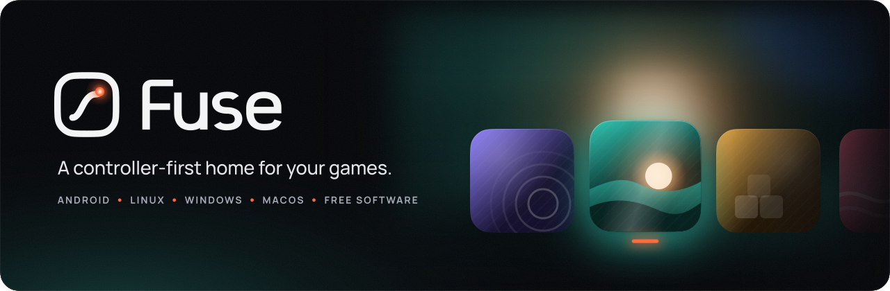
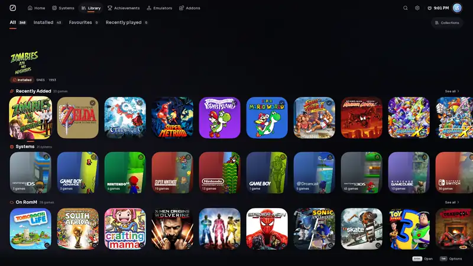
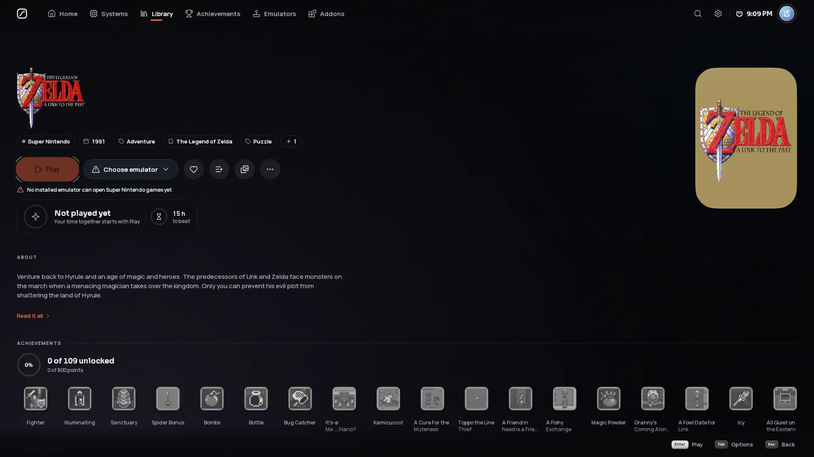
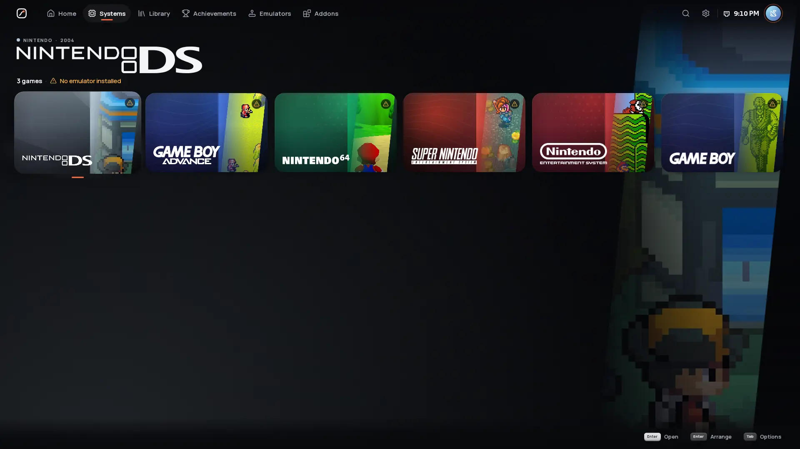
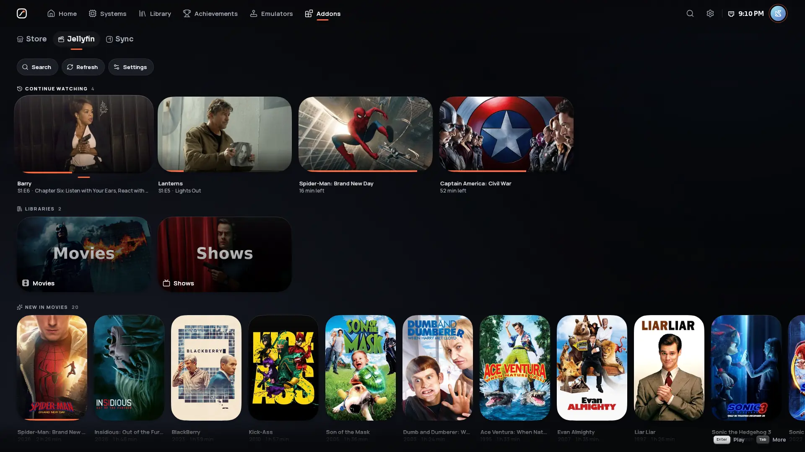
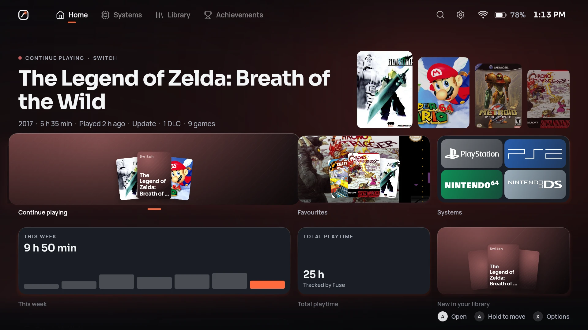
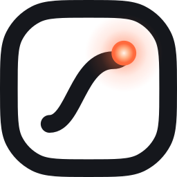

<div align="center">

<picture>
  <source media="(prefers-color-scheme: dark)" srcset="docs/assets/brand/banner-dark.svg">
  <source media="(prefers-color-scheme: light)" srcset="docs/assets/brand/banner-light.svg">
  
</picture>

<h3>Point it at your folders. Pick up a controller. Play.</h3>

Fuse gathers the games in your folders, dresses them in art and starts each one in the emulator you
already use, all from a console-style interface made for a gamepad. On Android it can even be your
Home screen.

<a href="https://github.com/MAtiyaaa/fuse/releases/latest"></a>
<a href="https://matiyaaa.github.io/fuse/"></a>

<a href="LICENSE"></a>
<a href="#privacy"></a>

<br>

<a href="https://github.com/MAtiyaaa/fuse/releases/latest"><picture><source media="(prefers-color-scheme: dark)" srcset="docs/assets/brand/button-android-dark.svg"></picture></a>
&nbsp;
<a href="https://github.com/MAtiyaaa/fuse/releases/latest"><picture><source media="(prefers-color-scheme: dark)" srcset="docs/assets/brand/button-linux-dark.svg"></picture></a>
<br>
<a href="https://github.com/MAtiyaaa/fuse/releases/latest"><picture><source media="(prefers-color-scheme: dark)" srcset="docs/assets/brand/button-windows-dark.svg"></picture></a>
&nbsp;
<a href="https://github.com/MAtiyaaa/fuse/releases/latest"><picture><source media="(prefers-color-scheme: dark)" srcset="docs/assets/brand/button-macos-dark.svg"></picture></a>

<sub>Android 9 or newer &nbsp;·&nbsp; 64-bit x86 Linux AppImage &nbsp;·&nbsp; Windows 10 and 11 &nbsp;·&nbsp; macOS on Apple silicon and Intel &nbsp;·&nbsp; <a href="#install">checksums and install notes</a></sub><br>
<sub>0.4.6 is the <b>Continue Update</b>: carry on where you left off on any device, your Journal with half-star ratings, your history brought in, Your Year, saves from anywhere, the same hotkeys in every emulator, and Skip Intro, lyrics and Quick Connect on Jellyfin</sub><br>
<sub>Or download from <a href="https://matiyaaa.github.io/fuse/">Fuse's website</a>, which always offers the latest version for your system.</sub>

<br>

<b><a href="#a-dark-room-lit-by-the-game-youre-on">Tour</a></b> &nbsp;&nbsp;·&nbsp;&nbsp;
<b><a href="#what-fuse-does">Features</a></b> &nbsp;&nbsp;·&nbsp;&nbsp;
<b><a href="#install">Install</a></b> &nbsp;&nbsp;·&nbsp;&nbsp;
<b><a href="#build-it-yourself">Build</a></b> &nbsp;&nbsp;·&nbsp;&nbsp;
<b><a href="#documentation">Docs</a></b>

</div>

<picture>
  <source media="(prefers-color-scheme: dark)" srcset="docs/assets/brand/divider-dark.svg">
  
</picture>

<div align="center">

## A dark room, lit by the game you're on

Every game, everywhere it lives: on this device, on your RomM server and on your other devices, in
one Library, with its art, its logo and where it is. The game you are on sets the mood, and the
tile under your thumb lifts toward you with a single sweep of light.

<a href="docs/assets/screenshots/library.webp"></a>

<sub><b>Library, All.</b> 348 games from this device, RomM and the household, in shelves you reach with a press.</sub>

<br><br>

<a href="docs/assets/screenshots/tour.mp4"></a>

<sub><b>A short tour.</b> <a href="docs/assets/screenshots/tour.mp4">Watch it as a video</a>.</sub>

</div>

<table>
  <tr>
    <td width="50%" valign="top">
      <a href="docs/assets/screenshots/game-page.webp"></a>
      <br><b>A page for every game</b>
      <br><sub>Its details, how long it takes to beat, its achievements, where it is, its saves, patches and cheats, and which emulator starts it.</sub>
    </td>
    <td width="50%" valign="top">
      <a href="docs/assets/screenshots/systems.webp"></a>
      <br><b>Systems, with art of their own</b>
      <br><sub>Logos, art and colours for 157 systems, each with its game count, its emulator and its own page.</sub>
    </td>
  </tr>
  <tr>
    <td width="50%" valign="top">
      <a href="docs/assets/screenshots/jellyfin.webp"></a>
      <br><b>Films, shows and music</b>
      <br><sub>Your Jellyfin server, played by Fuse Player: continue watching, next up, seasons, music and search.</sub>
    </td>
    <td width="50%" valign="top">
      <a href="docs/assets/screenshots/home-channels.webp"></a>
      <br><b>Home, a board you arrange</b>
      <br><sub>Continue playing, your systems, what's new, picks for you, achievements, Jellyfin and more, as tiles you place and resize.</sub>
    </td>
  </tr>
</table>

<p align="center"><sub>Captured from Fuse 0.4.2.13 and earlier on Linux at 1920 x 1080, with a real household library, RomM and Jellyfin, and the art Fuse filled
in for them. The games, films, their names and their art belong to their owners.
Fuse comes with no games and is not affiliated with them.</sub></p>


<div align="center">

## What Fuse does

</div>

<table>
  <tr>
    <td width="33%" valign="top">
      <br>
      <b>Your folders, understood</b><br>
      <sub>157 systems by folder name, multi-disc sets, updates and DLC, PS3, PS4 and Vita installs, drives that come and go. Your files are never moved or renamed.</sub>
    </td>
    <td width="33%" valign="top">
      <br>
      <b>Starts the emulator you use</b><br>
      <sub>Over 100 emulators and launchers on Android and 35 on computers, each documented, with their settings, patches and cheats changed from Fuse.</sub>
    </td>
    <td width="33%" valign="top">
      <br>
      <b>Fuse One</b><br>
      <sub>Profiles, saves in over 60 emulators, play time and settings on every device, from a host of your own. <a href="docs/sync.md">How it works</a></sub>
    </td>
  </tr>
  <tr>
    <td width="33%" valign="top">
      <br>
      <b>RomM, built in</b><br>
      <sub>Browse your server, download games and BIOS into your folders, upload yours, sync saves, with an offline copy. Cartridge works too. <a href="INTEGRATIONS.md">Details</a></sub>
    </td>
    <td width="33%" valign="top">
      <br>
      <b>Controller, touch, keyboard, mouse</b><br>
      <sub>Made for a gamepad, with hints for Xbox, Nintendo and PlayStation, and every screen answers a finger, a mouse and the keyboard.</sub>
    </td>
    <td width="33%" valign="top">
      <br>
      <b>Films, shows and music</b><br>
      <sub>Your Jellyfin server, played by Fuse Player, Fuse's own player. <a href="docs/player.md">How it works</a></sub>
    </td>
  </tr>
  <tr>
    <td width="33%" valign="top">
      <br>
      <b>Every achievement, one page</b><br>
      <sub>RetroAchievements, trophies from RPCS3, shadPS4 and Vita3K, Xenia's and Steam's, mixed by time. Kept for offline.</sub>
    </td>
    <td width="33%" valign="top">
      <br>
      <b>21 themes, and yours</b><br>
      <sub>Each with its own room, corners, motion and sounds, and a Theme Studio to make your own. <a href="docs/THEMES.md">Write one</a></sub>
    </td>
    <td width="33%" valign="top">
      <br>
      <b>Private by design</b><br>
      <sub>No telemetry, analytics, ads or crash reporting. A service is used only once you set it up. <a href="INTEGRATIONS.md">What each one receives</a></sub>
    </td>
  </tr>
</table>

Ports and recomps beside your emulators, Phone Link, Moonlight streaming, Steam's Game Mode, a
second-screen companion, Storage, backups and System health: everything is in
[docs/features.md](docs/features.md).

## Where Fuse stands

> [!IMPORTANT]
> **Fuse 0.4.6 "The Continue Update"**: Fuse remembers the person, not only the games. Continue
> carries on from the moment you stopped, on this device or another; the Journal keeps where you
> are with each game, a rating in half stars and a note; Move In brings the years before Fuse from
> ES-DE, RetroArch, Pegasus, Steam and RetroAchievements; Your Year recaps your play; saves from
> any tool or console come home; one set of hotkeys works in every emulator; downloads can wait for
> the charger; and on Jellyfin, Skip Intro, lyrics, subtitles found online and Quick Connect. See
> [the release notes](docs/releases/0.4.6.md); every earlier release is in
> [CHANGELOG.md](CHANGELOG.md).

Fuse runs on Android handhelds and phones, Linux (SteamOS and its Game Mode too), Windows and macOS,
and every screen is checked at 23 screen sizes. Not there yet: translations and native patches for
Android emulators ([ROADMAP.md](ROADMAP.md)). Tried it on your device? A short report helps: [open
an issue](https://github.com/MAtiyaaa/fuse/issues) or see [CONTRIBUTING.md](CONTRIBUTING.md).

## Install

Download the latest files from the [Releases page](https://github.com/MAtiyaaa/fuse/releases/latest):

| File | For |
|---|---|
| `Fuse-<version>-android.apk` | Android 9 or newer |
| `Fuse-<version>-x86_64.AppImage` | 64-bit x86 Linux |
| `Fuse-<version>-windows-x64.msi` | Windows 10 and 11, 64-bit (installer) |
| `Fuse-<version>-windows-x64.zip` | Windows 10 and 11, 64-bit (portable) |
| `Fuse-<version>-macos-arm64.dmg` | Macs with Apple silicon, macOS 11 or newer |
| `Fuse-<version>-macos-x64.dmg` | Intel Macs, macOS 10.15 or newer |
| `SHA256SUMS.txt` | Checksums for all of them |

The APK is published first; the computer builds join the release a little later.

Check what you downloaded:

```sh
sha256sum -c SHA256SUMS.txt --ignore-missing
```

<table>
  <tr>
    <td width="50%" valign="top">
      &nbsp;<b>Android</b>
      <p>Open the APK and allow your browser or file manager to install apps when asked. Fuse works as a normal app; making it your Home screen is optional and offered during setup.</p>
      <p>To read your folders and hand games to emulators that need file paths or FileProvider links, Fuse asks for All files access, the same access ES-DE uses. Fuse only reads: it never moves, renames or deletes your files.</p>
    </td>
    <td width="50%" valign="top">
      &nbsp;<b>Linux</b>
      <p>Make the AppImage executable and run it:</p>
      <pre><code>chmod +x Fuse-*-x86_64.AppImage
./Fuse-*-x86_64.AppImage</code></pre>
      <p>If it does not start, your distribution may need the FUSE 2 library (<code>libfuse2</code>, or <code>libfuse2t64</code> on newer Ubuntu and Debian). See the <a href="https://docs.appimage.org/user-guide/troubleshooting/fuse.html">AppImage FUSE guide</a>.</p>
      <p>On KDE Plasma with Wayland and a scaled screen (a 4K TV at 200%, say), set System Settings, Display and Monitor, Legacy Applications (X11) to <b>Apply scaling themselves</b>. Fuse is then drawn sharp and sizes itself for the screen; otherwise the system stretches it and it looks soft.</p>
    </td>
  </tr>
  <tr>
    <td width="50%" valign="top">
      &nbsp;<b>Windows</b>
      <p>Run the <code>.msi</code>: it installs Fuse for your account, with no administrator prompt, and a later version installs over it. Or unzip the portable <code>.zip</code> anywhere (a USB drive works) and run <code>Fuse.exe</code>; it keeps its library and settings in the <code>FuseData</code> folder beside it.</p>
      <p>Fuse isn't signed by Microsoft yet, so SmartScreen may warn the first time: choose <b>More info</b>, then <b>Run anyway</b>.</p>
    </td>
    <td width="50%" valign="top">
      &nbsp;<b>macOS</b>
      <p>Open the disk image for your Mac (<code>arm64</code> for Apple silicon, <code>x64</code> for Intel) and drag Fuse to Applications.</p>
      <p>Fuse isn't notarized by Apple yet. The first time, right-click Fuse and choose <b>Open</b>, or allow it in System Settings, Privacy &amp; Security. From Terminal, this does the same:</p>
      <pre><code>xattr -dr com.apple.quarantine /Applications/Fuse.app</code></pre>
    </td>
  </tr>
</table>

Fuse does not include emulators, BIOS files or games. Install the emulators you want; Fuse finds them
automatically.

## Build it yourself

You need JDK 17 or newer and, for Android, the Android SDK with API level 37 installed.

```sh
./gradlew :app:android:assembleDebug   # Android debug APK
./gradlew :app:desktop:run             # run the desktop app
./gradlew allTests                     # every test
```

[BUILDING.md](BUILDING.md) covers tests per module, the AppImage and release signing.

## Privacy

Fuse contains **no telemetry, analytics, advertising or crash reporting**, and your library works
fully offline. A service is contacted only after you set it up; the one used without setup is
GitHub, to check for new versions of Fuse (turn it off in Settings, About). Keys and passwords stay
in the system's secure storage, never in logs or the database. [INTEGRATIONS.md](INTEGRATIONS.md)
lists what each service receives and when.

## Documentation

| Document | What it covers |
|---|---|
| [ARCHITECTURE.md](ARCHITECTURE.md) | Modules, domain model, scanning, launching, input, storage, security |
| [INTEGRATIONS.md](INTEGRATIONS.md) | Every online service and the Cartridge bridge, and what leaves the device |
| [DESIGN_SYSTEM.md](DESIGN_SYSTEM.md) | Tokens, type, focus, motion, themes, sound, accessibility |
| [docs/features.md](docs/features.md) | Everything Fuse does, part by part |
| [docs/sync.md](docs/sync.md) | Fuse One: profiles, save sync, the Fuse Library, hosting, what syncs, conflicts, security, and Syncthing instead |
| [tools/host/README.md](tools/host/README.md) | The Fuse One Host: installing, updating, backing up and removing it |
| [docs/fuseline-sdk.md](docs/fuseline-sdk.md) | Using Fuseline in your own Compose Multiplatform app |
| [docs/player.md](docs/player.md) | Fuse Player by Fuse: engines, subtitles, controls, two screens |
| [docs/fuseline.md](docs/fuseline.md) | Fuseline by Fuse: curves, springs, transitions and how fast it is |
| [docs/jellyfin.md](docs/jellyfin.md) | Jellyfin in Fuse: connecting, home and away, what is sent |
| [docs/PHONE_LINK.md](docs/PHONE_LINK.md) | Phone Link: your phone as a window on the library, a keyboard and a controller |
| [docs/THEMES.md](docs/THEMES.md) | Writing, sharing and adding themes |
| [RESEARCH.md](RESEARCH.md) | What we learned about frontends, Android, emulators, RomM and scrapers |
| [ROADMAP.md](ROADMAP.md) | What is done and what comes next |
| [BUILDING.md](BUILDING.md) | Building, testing, packaging and signing |
| [CONTRIBUTING.md](CONTRIBUTING.md) | How to contribute |
| [CHANGELOG.md](CHANGELOG.md) | Release history |
| [THIRD_PARTY_NOTICES.md](THIRD_PARTY_NOTICES.md) | Licences of everything Fuse uses |

## Licence

Copyright (C) 2026 the Fuse contributors.

Fuse is free software: you can redistribute it and/or modify it under the terms of the GNU General
Public License as published by the Free Software Foundation, either version 3 of the License, or (at
your option) any later version (`GPL-3.0-or-later`). See [LICENSE](LICENSE). Fuse is distributed in
the hope that it will be useful, but without any warranty.

Third-party components keep their own licences; see [THIRD_PARTY_NOTICES.md](THIRD_PARTY_NOTICES.md).

## Credits

- **Fuse One**, **Fuse Player by Fuse** and **Fuseline by Fuse**, Fuse's own household system,
  media player and animation engine, written for Fuse and part of this repository, under its licence.
- [ES-DE](https://es-de.org/), whose MIT-licensed emulator configuration is the best public record of
  how emulators accept games.
- [RomM](https://github.com/rommapp/romm), whose folder conventions, platform names and alias table Fuse follows.
- **[Cartridge](https://github.com/abdu2304/cartridge) by [abdu2304](https://github.com/abdu2304)**
  (MIT), the RomM companion Fuse pairs with, and where Fuse learned to match emulator forks by name
  and to know an AppImage by what it updates from.
  Fuse's bridge (live downloads, deep links and uploads) is being contributed to Cartridge; until
  it is merged there, Fuse installs Cartridge from the [MAtiyaaa/cartridge](https://github.com/MAtiyaaa/cartridge)
  fork, and will switch to abdu2304's releases once it is.
- [Jellyfin](https://jellyfin.org/), the free media server Fuse plays your films, shows and music
  from, and [FFmpeg](https://ffmpeg.org/) (through [JavaCPP](https://github.com/bytedeco/javacpp-presets))
  and [Media3](https://developer.android.com/media/media3), which Fuse Player by Fuse decodes with.
- [rcheevos](https://github.com/RetroAchievements/rcheevos) and
  [RetroAchievements](https://retroachievements.org/).
- **Music by boipurple.** Fuse's menu music is boipurple's albums *jam channel* and *creature
  interchange*: puddleworld plays under the menus and alright apothecary during setup, and every
  song can be picked in Settings, Sound, shuffled, or skipped from the quick menu. The songs remain the artist's own and are not covered by Fuse's
  licence.
- [Lucide](https://lucide.dev/) icons (ISC), and the [Sora](https://github.com/sora-xor/sora-font) and
  [Manrope](https://github.com/googlefonts/manrope) typefaces (SIL Open Font License).
- Kotlin, Compose Multiplatform, SQLDelight, Ktor, Coil and kotlinx libraries.
- The emulator and launcher developers whose work Fuse starts.

<sub>iiSU was studied as a reference for quality only; no code or assets were taken from it, nor from
Sony, Microsoft or Nintendo. Console and game names are trademarks of their owners and are used only
to identify systems. Fuse ships no console artwork, console sounds, BIOS files or games.</sub>

<br>

<div align="center">
<picture>
  <source media="(prefers-color-scheme: dark)" srcset="docs/assets/brand/mark-dark.svg">
  
</picture>
<br>
<sub>Fuse is free software, made in spare time for everyone who plays with a controller.</sub>
</div>
